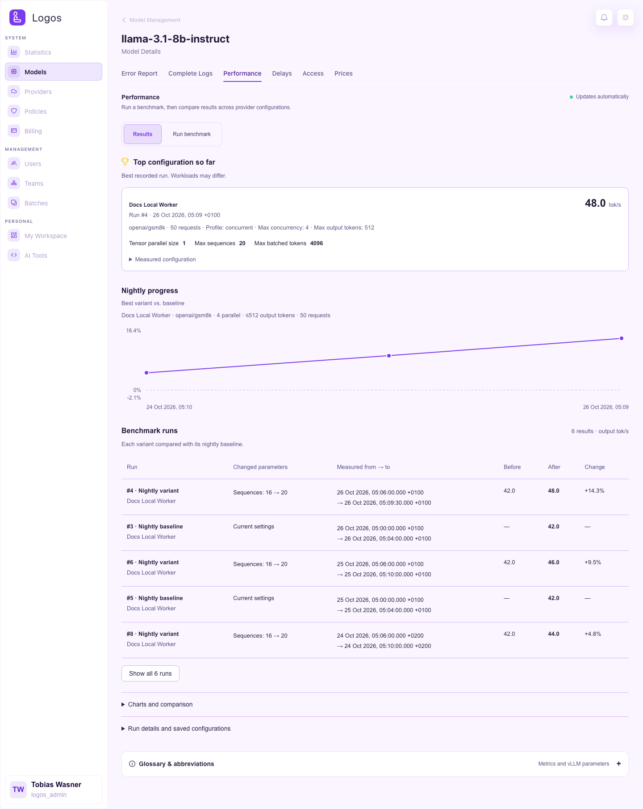
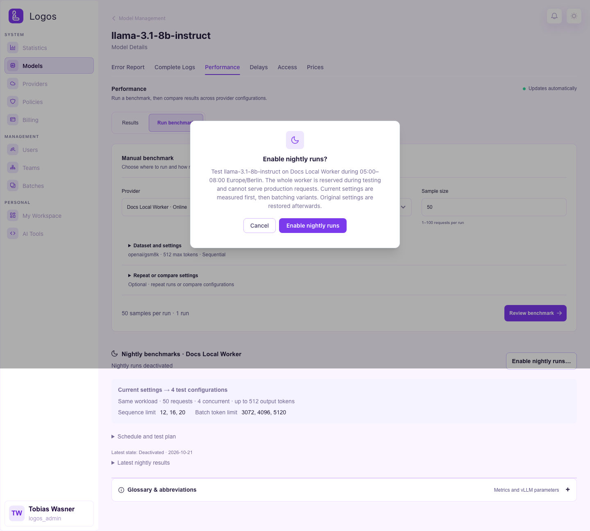
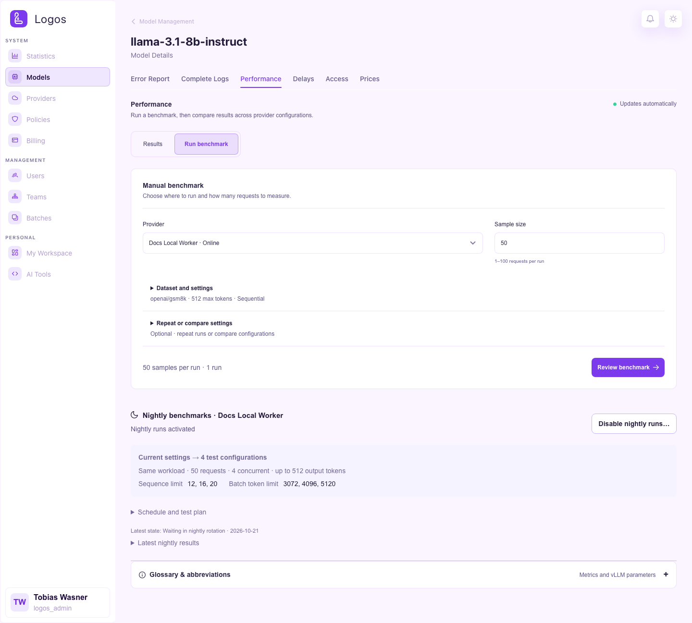
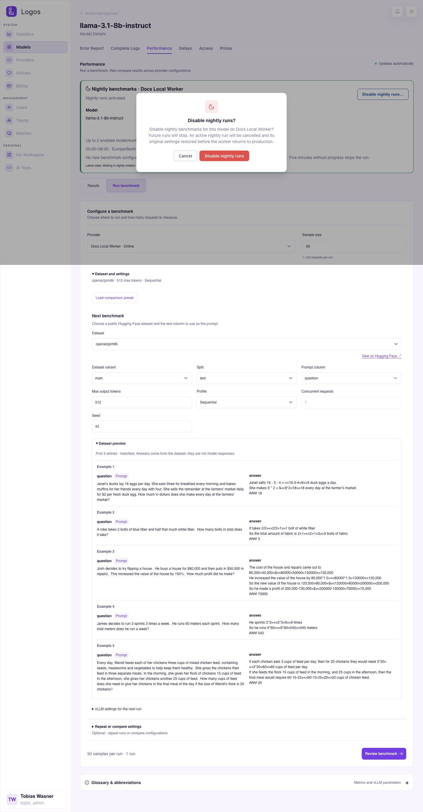

# Logos Admin

The Logos Admin role (`logos_admin`) has full access to the platform. This
includes every page in the UI, also the pages for operators. On the identity
provider, an account becomes a Logos Admin if the account has the OIDC role
that is configured in `KEYCLOAK_ROLES_LOGOS_ADMIN` (see the
[installation guide](../admin/installation.md)).

The UI shows the role badge "Logos Admin" in the header menu.

## Statistics

This page shows the usage of the complete platform: the request volume, the
token counts and the latency over time. The page gets live updates from the
WebSocket statistics feed. If you delete a model, its usage stays in these
views. The historical requests stay under the former name of the model. A
trash icon marks the entry as deleted.

On the **Requests** tab, the filter row narrows the page to one team,
requester and provider, and to a set of models. A requester is a person or an
application key. An application key has no person behind it, so the
**Requesters** list shows it as `App key: <team> · <environment>`. Use this
entry to see the traffic of one deployment only, for example the production
key of a team. The list shows the number of requests for each entry and puts
the entries with the most requests first.

The time range and every filter apply to the whole tab at once. The totals,
the charts and the recent requests always show the same requests. This is also
true when you drag across the request volume chart to select a time range. Only
the state filter applies to the recent requests alone.

On the **Local Providers** tab, each worker node has its own section. The
section shows memory, lane health and GPU metrics. Next to the name of the
worker, the page shows `version: <commit>` and an info icon. `<commit>` is the
commit from which the image was built. To see the full commit, hold the
pointer over the icon, or tap it on a touch screen. Use the button there to
copy the commit. With this information, you can find which workers have the
update. If a worker cannot report a commit, the page shows `version: unknown`.
The icon then shows the reason.

### Maintenance status

Above the workers, the **Maintenance** box shows what holds the maintenance
slot. Calibration, benchmarks and nightly recovery share this slot. While one
of them holds it, the others cannot start. The box shows the kind of work, the
worker and the time when the work started. If nothing holds the slot, the box
shows **Free**.

- **Calibrating**: click **Stop calibration** to end the calibration.
- **Benchmarking**: click **Cancel benchmark** to end the benchmark.
- **Nightly recovery**: the scheduler puts the original settings of the
  worker back. This usually ends on its own. If it does not, click
  **Release recovery**. Logos checks that the model runs its original settings
  again, and then frees the slot.

A worker confirms the end of its calibration before the slot is free again. An
offline worker cannot confirm it, and neither can a worker with old software.
For these workers, and after a stop that did not free the slot, the box shows
**Release claim**. Logos tries a normal stop first. If the worker still reports
a calibration, the claim stays. The claim also stays if the worker is online
but does not answer. Try again later, or wait until the worker is offline. Otherwise Logos releases it and records the
release in the audit log. Release the claim of an offline worker only if the
worker cannot continue the calibration.

If Logos cannot check the settings, for example because the worker is
offline, it refuses the release. The box then shows **Force release**. A forced
release frees the slot without the check. The model keeps the settings it has
now, and these can be benchmark settings. Check the model on the worker first.
The audit log records every release.

The box updates together with the rest of the page.

### Idle lanes and lane locks

The capacity planner puts a lane to sleep after the lane has no requests for
30 minutes (`LOGOS_IDLE_SLEEP_L1_S`, see
[deployment](../deployment.md#environment-variables)). A sleeping lane frees
most of its GPU memory. The next request to the lane must wait until the lane
wakes.

To keep a lane warm, lock it. In the lane list of a worker, click the lock icon
next to the lane. A closed lock shows a locked lane. The capacity planner does
not put a locked lane to sleep and does not unload it to make memory free for
other models. If a locked lane sleeps, the planner wakes it. To release the
lane, click the lock icon again. The lock stays after a restart of Logos. Only a
Logos admin can lock or unlock a lane.

A worker that restarts comes back without lanes. The capacity planner then loads
each locked lane again. It uses the same model, the same GPUs and the same
settings as before the restart. If you unload a locked lane, the planner does
not load it again.

The **Sleep** action on a locked lane still puts the lane to sleep. Use it only
if you must make memory free at once. The planner then wakes the locked lane
again.

### Worker locks

To keep all lanes of a worker as they are, lock the worker. Above the lane list
of the worker, click **Lock worker**. While the worker is locked, the capacity
planner does not load, wake, put to sleep or unload a lane on that worker.
Requests go to a lane of the worker only while that lane is awake. Automatic
calibration and nightly benchmarks skip the worker, and you cannot start a
benchmark there.

Your own actions in the lane list still work: **Load lane**, **Unload**,
**Sleep**, **Wake** and **Drain**. After a restart of the worker, the planner
loads all lanes again on the same GPUs. A lane that was asleep before the
restart goes to sleep again. To release the worker, click **Worker locked**.

### Parallel lane actions

A worker unloads a lane at once, also while it loads or wakes another lane. It
loads two lanes at the same time only if they use different GPUs. If the only
GPUs that fit are in use by a lane that loads, the second lane waits until the
first lane has started.

## Models

This page shows the model catalogue of the deployment. It shows tags, aliases,
capabilities and scheduling weights for each model. It also shows the Likert
**profile ratings** (latency / quality / price) as a spider chart. Click a
model to open its **Model Details** view. This view shows the request history,
the error reports and the scheduling statistics of the model.

Select the **Nightly benchmark** column header to sort by status.
Select it again to reverse the order.

The **Nightly benchmark** column shows the planned rotation for each model/worker pair.
Blue means a candidate for the next window. Yellow means a later place in the rotation.
Green marks a successful measurement within 7 days. Red means the pair is blocked.
Point to a status for the worker and date. Select it to open **Performance**.
The preview depends on current worker availability. It does not reserve a worker.

The **Delays** tab of the **Model Details** view shows where the time of a
request goes. The tab shows local and cloud providers. It has one row for each
provider of the model and for each reasoning effort. A **Local** or **Cloud** tag
next to the provider name shows the provider type. The row shows these values,
each as the median (p50) and as the 95th percentile (p95):

- **Logos wait**: the time from the arrival of the request at Logos until the
  call to the provider. This includes the authentication, the rate limit, the
  budget check and the scheduling.
- **Provider**: the time from the call to the provider until the end of the
  response.
- **TTFT**: the time from the arrival of the request until the first token.
  **TTFT N** shows how many requests these values come from: only requests
  that sent a first token count. If this number is less than **Requests**,
  the cell also shows the number of requests (for example, "5 of 60").

The **Effort** column shows the reasoning effort that Logos sent to the
provider. Some local models accept only some effort levels. For these models,
Logos changes the effort of the client to the nearest level that the model
accepts. The column then shows the changed level, not the level of the client.
The value `default` shows that the request did not contain an effort.

If the **Logos wait** values increase, Logos itself slows the requests down.
Use the time range bar of the tab to select the period.

### Model benchmarks

Open the model's **Performance** tab to configure and start a benchmark.
The orchestrator reserves the selected model lanes during a worker benchmark.
The [Model Benchmarks guide](../admin/model-benchmarks.md) explains the confirmation dialog, single-run charts, batches and failed-model retries.

The **Results** tab shows **Top configuration so far** for each model/provider.
This is the highest recorded output throughput among fully successful runs.
Select **Measured configuration** to see the saved benchmark settings and serving parameters.
Runs can use different workloads. This record does not prove an improvement under identical conditions.
The application does not apply these parameters automatically.

**Nightly progress** shows the best successful variant against its baseline for each completed test plan.
The chart separates runs with different captured workloads or other serving settings.
Select a point to read its run number, time and percentage change.
The chart does not show automatic parameter adoption or statistical significance.
The table shows the latest 5 runs. Select **Show all** to read older results.

### Nightly benchmarks

The **Performance** tab provides nightly benchmarks for each model/worker pair.
Calibration runs first. Benchmarks use the remaining time.
The configured maintenance limit controls simultaneous workers, including manual starts. The default is 1 worker.
Schedules are off by default. Activation requires an updated, connected worker.
See [deployment requirements](../deployment.md#nightly-benchmarks) before activation.
See the [nightly benchmark guide](../admin/nightly-benchmarks.md) for rotation, parameter values and recovery rules.

1. Open a model from **Models**.
2. Select **Performance**.
3. Select **Run benchmark** and find **Nightly benchmarks** for the intended worker.
4. Expand **Schedule and test plan**.
5. Select **Enable nightly runs…**.
6. Read the dialog and select **Enable nightly runs**.

Select **Cancel** to keep the current schedule state.
The confirmation dialog shows the time window and the effect on production traffic.

The card then shows **Enabled · in nightly rotation**.
The schedule stays active after a page reload.
Each night, Logos selects up to 2 eligible pairs, with new or older attempts first.
The card shows possible parameter values for this pair, not a guaranteed place for tonight.

The example uses illustrative measurements and an active nightly schedule.
Use **Manual benchmark** to configure a run during the day.
These controls do not change the nightly workload.

To remove the pair from the nightly rotation:

1. Select **Disable nightly runs…**.
2. Read the dialog and select **Disable nightly runs**.
3. Check that the card shows **Disabled · not scheduled**.

Select **Cancel** to keep the schedule active.
Deactivation stops an active benchmark and restores the worker configuration before production resumes.

## Providers

This page shows each provider that the deployment knows. These are cloud
providers (Azure, OpenAI and others) and connected worker nodes. For each
provider, the page shows the status and the connected models. It also shows the
worker control actions (calibrate, sleep, wake, lane management).

## Policies

Policies are the rules that decide which models a team or an API key can use.
You assign policies to each team. The orchestrator evaluates them for every
request.

## Billing

This page shows the costs for each team, model and provider. Logos calculates
the costs from the usage logs and from the configured catalogue prices.

## Users

This page shows all users of the deployment, with their role, teams and
status. Logos Admins can create users and roles, and can assign users to other
roles. An App Admin can manage only App Developers.

## Teams

This page shows the teams, their owners and their members. A team that gets its
members from Keycloak has a lock badge. The badge shows the name of the linked
group.

### Keycloak Group Links

A team can get its members from a Keycloak group or a realm role. Then you do
not add the members by hand. Only a Logos Admin sees this field, because a team
owner controls the members, not the identity provider.

To make the link, type the name of the group in the **New Team** dialog, or
later in the **Settings** tab of the team. To remove the link, make the field
empty.

A link has these effects:

- Each member of the group joins the team at the next login of that person, and
  at the nightly directory sync.
- Logos removes a person from the team at the first login after that person
  leaves the group.
- You cannot add or remove these members in the **Members** tab.
- One group gives its members to one team only. You cannot link the platform
  admin roles (`KEYCLOAK_ROLES_LOGOS_ADMIN` and `KEYCLOAK_ROLES_APP_ADMIN`),
  because these roles give a role and not a team.
- You cannot rename or delete the team while the link is in place. Remove the
  link first. This also removes the members that Keycloak added.

If the deployment can read the realm (`logos.auth.sync.enabled=true`), then the
field shows the groups and the realm roles of the realm. It also shows how many
of them you can select. If the deployment cannot read the realm, then type the
name exactly as the login claim contains it. This is a group path without the
first `/`.

The **Settings** tab of the team shows the same field. For a linked team, this
tab shows a note in place of the Danger Zone, because you cannot rename or
delete the team.

When you open a team, you see the same detail tabs as an owning App Admin sees.
For the tabs Overview to Settings, see [App Admin → Teams](app-admin.md#teams).
Logos Admins also get a **Providers** tab. This tab shows which cloud
providers and worker providers the team can use.

## Agent Sessions

This page shows the coding-agent sessions of the
[agent runner](https://github.com/ls1intum/edutelligence/blob/main/logos/logos-agent/README.md).
For each session, it shows the work, the state and the pull request. Every
Logos Admin can open the page. The **Agents** entry in the sidebar shows only
if the deployment runs the optional agent stack.

Repository analyses of the linked repositories of the teams also run here.
Each night, they run again for repositories that have new commits. **Analyze
all repositories** immediately queues an analysis for every linked repository,
also if there are no new commits. Use it, for example, after an improvement of
the analysis. It does not change repositories that already have an analysis
that is queued or that runs. The results go to the teams as proposals on their
**Workflows** tab ([Team detail](app-admin.md#workflows)).

## My Workspace

This page is the developer view of the signed-in user. It shows the teams of
the user and the API keys of the user. You can create, rotate and revoke keys.
You can also set model permissions for each key. Every role that has at least
one team and one key can use this page.

## AI Tools

This is the same guided setup as for every other role. Select a coding
assistant, a team key and a model. Then install the assistant and connect it.
The page does not change with the role. For the step-by-step procedure, see
[App Developer → AI Tools](app-developer.md#ai-tools).

## Batches

This is the same Batch UI as for the App Admin. Upload a `.jsonl` file, look at
the progress and download the results. See [App Admin → Batches](app-admin.md#batches).
